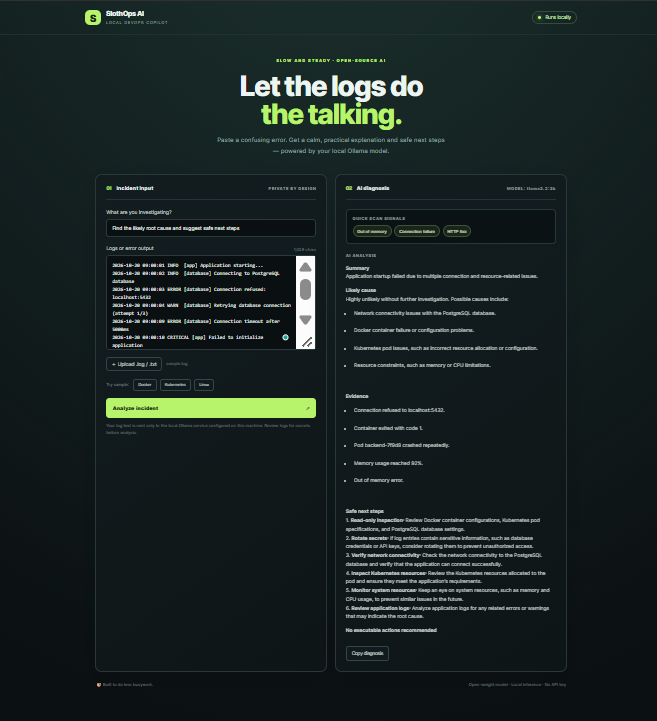

# 🦥 SlothOps AI

**Work less. Automate more. Stay in control.**

SlothOps AI is a local-first DevOps log analyzer powered by an open-weight model through [Ollama](https://ollama.com/). Paste or upload logs from Docker, Kubernetes, Linux, CI/CD, or an application and get a plain-English diagnosis, likely causes, and safe next steps.

## Why it fits “Slow and Steady”

- **Open AI at the core:** uses a locally served open-weight model rather than a hosted proprietary AI API.
- **Privacy by design:** the log analysis request goes to your configured Ollama service. The app itself does not upload logs to a third-party AI API.
- **Swap models:** change `OLLAMA_MODEL` to a model available in your Ollama installation.
- **Low recurring cost:** no per-request AI API bill; you supply the machine resources and storage.
- **Human in control:** it analyzes and suggests. It does not execute shell commands or make infrastructure changes.

> Local inference is only as private as your setup. Use a local Ollama endpoint, don't expose it publicly, and remove credentials/tokens from logs before analysis.

## Project Screenshot



## Features

- Local AI diagnosis with summary, likely cause, evidence, and next steps
- Quick pattern scan for memory, permissions, network, disk, container, exception, and HTTP 5xx errors
- Paste logs or upload `.log`, `.txt`, `.out`, `.json`, or YAML text files
- Sample Docker, Kubernetes, and Linux incidents
- Copyable diagnosis
- Dark responsive dashboard
- No API key required

## Architecture

```text
Browser
  │ logs pasted/uploaded
  ▼
Flask web app (127.0.0.1:5000)
  ├── Quick regex-based error scan
  └── HTTP request to local Ollama
          └── Open-weight model (default: llama3.2:3b)
                    ▼
             Diagnosis in browser
```

## Requirements

- Python 3.10+
- [Ollama](https://ollama.com/download)
- Enough RAM for your chosen model (3B models are a reasonable starting point on many modern machines; performance varies)

## Run locally

### 1. Install and start Ollama

Install Ollama for your operating system, then run:

```bash
ollama pull llama3.2:3b
ollama serve
```

If Ollama is already running as a service, you do not need to start it a second time. Keep the Ollama API bound to localhost unless you deliberately configure secured remote access.

### 2. Set up the Python app

```bash
git clone https://github.com/YOUR_USERNAME/slothops-ai.git
cd slothops-ai

python -m venv .venv
```

Activate the environment:

**Windows PowerShell**
```powershell
.\.venv\Scripts\Activate.ps1
```

**Linux/macOS**
```bash
source .venv/bin/activate
```

Install and launch:

```bash
pip install -r requirements.txt
python app.py
```

Open http://127.0.0.1:5000 in your browser.

### Optional: choose another installed Ollama model

**Linux/macOS**
```bash
export OLLAMA_MODEL="qwen2.5:3b"
export OLLAMA_URL="http://localhost:11434"
python app.py
```

**Windows PowerShell**
```powershell
$env:OLLAMA_MODEL="qwen2.5:3b"
$env:OLLAMA_URL="http://localhost:11434"
python app.py
```

Pull the model first, for example `ollama pull qwen2.5:3b`. The model name must match one available in Ollama.

## Docker (optional)

The app container needs to reach Ollama on the host. Build it:

```bash
docker build -t slothops-ai .
```

On Docker Desktop, you can usually run:

```bash
docker run --rm -p 5000:5000 \
  -e OLLAMA_URL=http://host.docker.internal:11434 \
  -e OLLAMA_MODEL=llama3.2:3b \
  slothops-ai
```

On Linux, `host.docker.internal` may require `--add-host=host.docker.internal:host-gateway`. The Docker image binds the Flask app to `0.0.0.0` inside the container so the published port works. Keep the published port local unless you intentionally want network access. For a simple local run, the Python setup above is the recommended path.

## Try it

Click one of the sample buttons in the app:
- **Docker:** port 8080 already in use
- **Kubernetes:** pods cannot be scheduled due to insufficient memory
- **Linux:** disk is full

Then click **Analyze incident**.

## API

`POST /api/analyze`

```json
{
  "task": "Find the likely root cause",
  "logs": "Error: no space left on device"
}
```

`GET /health` returns basic app status and the configured model name.

## Safety and limitations

- AI output can be wrong. Validate suggestions before using them in production.
- The app never executes generated commands.
- Don't paste passwords, access tokens, private keys, or customer data.
- Logs are truncated to 30,000 characters before model analysis.
- Uploads are read into the browser and sent to the local app; files are not saved to disk by this application.
- The quick scan uses simple patterns and is not a replacement for full observability tooling.
- This starter project has no authentication; do not expose it to a public network without adding authentication, HTTPS, rate limiting, and security review.

## Roadmap

- [ ] Export diagnosis as Markdown
- [ ] Add log redaction for common secret patterns
- [ ] Add Docker Compose for app + Ollama
- [ ] Add Kubernetes event parser
- [ ] Add unit tests and CI with GitHub Actions
- [ ] Add configurable model selection UI

## Contributing

Issues and pull requests are welcome. For changes, explain the problem, add a test where practical, and keep the local-first privacy promise intact.

## License

MIT — see [LICENSE](LICENSE).

## Built for Hacktoberfest: Slow and Steady

SlothOps AI demonstrates how open-weight models can make everyday DevOps work less tedious while giving developers control over where inference runs, which model they use, and how their data is handled.
